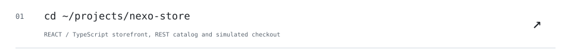
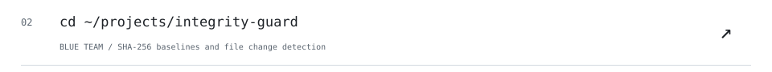
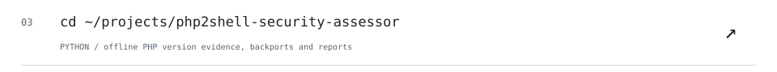

<!-- ALEFKAUE / SESSION 001 -->

<picture><source media="(prefers-color-scheme: dark)" srcset="./assets/session/boot.svg"></picture>

<a href="https://github.com/alefkaue/mini-soc-analyzer"><picture><source media="(prefers-color-scheme: dark)" srcset="./assets/session/project-01.svg"></picture></a><br>
<a href="https://github.com/alefkaue/pentest-ponto-cego"><picture><source media="(prefers-color-scheme: dark)" srcset="./assets/session/project-02.svg"></picture></a><br>
<a href="https://github.com/alefkaue/estagios"><picture><source media="(prefers-color-scheme: dark)" srcset="./assets/session/project-03.svg"></picture></a><br>

<details>
<summary><code>~ $ cat stack.json</code></summary>

```json
{
  "security": [
    "Linux",
    "Networking",
    "SIEM",
    "Pentest",
    "OSINT"
  ],
  "tooling": [
    "Nmap",
    "Wireshark",
    "Burp Suite"
  ],
  "languages": [
    "Python",
    "Bash",
    "SQL"
  ],
  "dev": [
    "Git",
    "Docker",
    "REST APIs"
  ],
  "learning": [
    "Blue Team",
    "Red Team",
    "Cloud Security"
  ]
}
```

</details>

<br>

<picture><source media="(prefers-color-scheme: dark)" srcset="./assets/session/activity.svg"></picture>

<details>
<summary><code>~ $ help</code></summary>

`projects/` — click a repository row above.  
`stack.json` — expand the toolbox.  
`activity.log` — real public contribution candles, refreshed daily.

</details>
