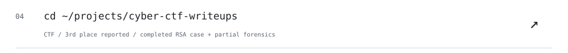
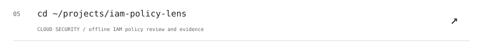
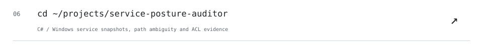

<!-- ALEFKAUE / SESSION 001 -->

<picture><source media="(prefers-color-scheme: dark)" srcset="./assets/session/boot.svg"></picture>

<picture><source media="(prefers-color-scheme: dark)" srcset="./assets/session/projects-head.svg"></picture>

<a href="https://github.com/alefkaue/simoc-integrador"><picture><source media="(prefers-color-scheme: dark)" srcset="./assets/session/project-01.svg"></picture></a> 
<a href="https://github.com/alefkaue/cyber-ctf-writeups"><picture><source media="(prefers-color-scheme: dark)" srcset="./assets/session/project-02.svg"></picture></a> 
<a href="https://github.com/alefkaue/php2shell-security-assessor"><picture><source media="(prefers-color-scheme: dark)" srcset="./assets/session/project-03.svg"></picture></a> 
<a href="https://github.com/alefkaue/jar-surface-auditor"><picture><source media="(prefers-color-scheme: dark)" srcset="./assets/session/project-04.svg"></picture></a> 
<a href="https://github.com/alefkaue/service-posture-auditor"><picture><source media="(prefers-color-scheme: dark)" srcset="./assets/session/project-05.svg"></picture></a> 
<a href="https://github.com/alefkaue/pcap-dns-guard"><picture><source media="(prefers-color-scheme: dark)" srcset="./assets/session/project-06.svg"></picture></a> 

<a href="./PORTFOLIO.md"><picture><source media="(prefers-color-scheme: dark)" srcset="./assets/session/projects-more.svg"></picture></a>

<picture><source media="(prefers-color-scheme: dark)" srcset="./assets/session/stack.svg"></picture>

<picture><source media="(prefers-color-scheme: dark)" srcset="./assets/session/languages.svg"></picture>

<picture><source media="(prefers-color-scheme: dark)" srcset="./assets/session/activity.svg"></picture>

<code>~ $ help</code>

`projects/` — click a repository row above.  
`./stack` — security toolkit and skills.  
`languages` — real byte share across public repos, refreshed daily.  
`activity.log` — real public contribution candles, refreshed daily.

## Education and recent work

I'm Alef Kaue Santos Nunes, a technical graduate in Systems Development (SENAI, 2025)
and a Cybersecurity technology-degree student at Faculdade SENAI São Caetano do Sul
(expected December 2027). I'm looking for my first opportunity in technology.

**CTF: 3rd place overall at my college** (participant-reported). The public write-ups
distinguish a completed RSA challenge from a partial forensic investigation.

The featured projects are academic/personal work. New tools were developed with AI assistance,
documented limits and automated tests; they are not claims of production security operations.

The language chart shows **real bytes in public, non-fork repositories**. Java and C# have their
own rows; HTML, CSS, Bicep and other secondary languages remain counted under **Other**.
Selection affects visibility, never the underlying totals. Byte share is not a proficiency score.
