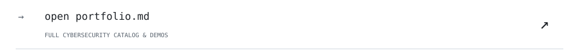

<!-- ALEFKAUE / SESSION 001 -->

<picture><source media="(prefers-color-scheme: dark)" srcset="./assets/session/boot.svg"></picture>

<picture><source media="(prefers-color-scheme: dark)" srcset="./assets/session/projects-head.svg"></picture>

<a href="https://github.com/alefkaue/ssh-watch"><picture><source media="(prefers-color-scheme: dark)" srcset="./assets/session/project-01.svg"></picture></a> 
<a href="https://github.com/alefkaue/integrity-guard"><picture><source media="(prefers-color-scheme: dark)" srcset="./assets/session/project-02.svg"></picture></a> 
<a href="https://github.com/alefkaue/iam-policy-lens"><picture><source media="(prefers-color-scheme: dark)" srcset="./assets/session/project-03.svg"></picture></a> 

<a href="./PORTFOLIO.md"><picture><source media="(prefers-color-scheme: dark)" srcset="./assets/session/projects-more.svg"></picture></a>

<picture><source media="(prefers-color-scheme: dark)" srcset="./assets/session/stack.svg"></picture>

<picture><source media="(prefers-color-scheme: dark)" srcset="./assets/session/languages.svg"></picture>

<picture><source media="(prefers-color-scheme: dark)" srcset="./assets/session/activity.svg"></picture>

<code>~ $ help</code>

`projects/` — click a repository row above.  
`./stack` — security toolkit and skills.  
`languages` — real byte share across public repos, refreshed daily.  
`activity.log` — real public contribution candles, refreshed daily.

<!-- PORTFOLIO-2026-10-23:BEGIN -->
## Education and recent work

I'm Alef Kaue Santos Nunes, a technical graduate in Systems Development (SENAI, 2025)
and a Cybersecurity technology-degree student at Faculdade SENAI São Caetano do Sul
(expected December 2027). I'm looking for my first opportunity in technology.

**CTF: 3rd place overall at my college** (participant-reported). My academic investigations
include a completed small-RSA challenge and a partial forensic challenge; the write-ups make
that distinction explicit.

- [PHP2Shell Security Assessor](https://github.com/alefkaue/php2shell-security-assessor):
  offline PHP inventory triage, version/backport evidence, lifecycle and static reports.
- [Cyber CTF Write-ups](https://github.com/alefkaue/cyber-ctf-writeups):
  sanitized academic investigations and reproducible Python teaching demos.
- [DNS Trace Investigator](https://github.com/alefkaue/dns-trace-investigator):
  offline DNS pattern triage, timed DHCP correlation and evidence provenance.

These are academic/personal projects developed with AI assistance and automated tests,
not claims of professional incident response or production deployment.
<!-- PORTFOLIO-2026-10-23:END -->
