<!-- Animated ASCII gallery — 10 colored artworks cycling on a loop -->
<h3><code>alefkaue@github ~ $ ./ascii-gallery.sh</code></h3>

 
 

<!-- Neofetch-style info card -->
<h3><code>alefkaue@github ~ $ neofetch</code></h3>

 
 

<!-- Live GitHub contributions heatmap, refreshed daily by a GitHub Action -->
<h3><code>alefkaue@github ~ $ ./contributions.sh</code></h3>

