<!-- Animated colored-ASCII Space Invader (reveal + cyber scanline) -->
<h3><code>alefkaue@github ~ $ ./invader.sh</code></h3>

 
 

<!-- Neofetch-style info card -->
<h3><code>alefkaue@github ~ $ neofetch</code></h3>

 
 

<!-- Live GitHub contributions heatmap, refreshed daily by a GitHub Action -->
<h3><code>alefkaue@github ~ $ ./contributions.sh</code></h3>

